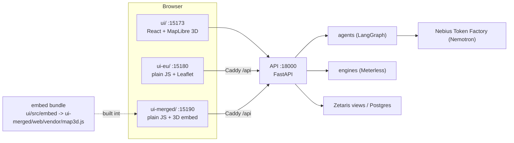

# The three UIs and their ports

FloodSense EU has one API and three interfaces on top of it. Pick the one you want to look at; they can run side by side.

| UI | Folder | Port | Start | What it is |
|---|---|---|---|---|
| Main console | `ui/` | 15173 | `docker compose -p floodsense-app -f compose.yaml -f local/compose.console.yaml up -d` | React 18, Vite, TypeScript. Citizen, Insurer and Civil protection desks, MapLibre 3D map (terrain, animated rivers, gauge pins and zoom dials, red live over-threshold gauges, region focus), agent heartbeat, replay. |
| Role UI | `ui-eu/` | 15180 | `docker compose -f compose.yaml -f compose.eu.yaml up -d` | Plain HTML, CSS and JS, no build. Leaflet 2D maps. Live at the hosted demo under `/eu/`. |
| Merged UI | `ui-merged/` | 15190 | `docker compose -p floodsense-merged -f compose.merged.yaml up -d` | The role UI with the 3D map embedded in the Insurer, Civil protection and Citizen views. Falls back to Leaflet when WebGL or the bundle fails. |
| API | `api/` | 18000 | part of the main stack | FastAPI. All three UIs call it (`/api/*`). |

The merged UI proxies `/api` to `host.docker.internal:18000` (override with `API_UPSTREAM`), so start the main stack first. It shares no network with it, and stopping it does not touch the main stack: `docker compose -p floodsense-merged -f compose.merged.yaml down`.

## The 3D embed

`ui/src/embed/map3d.tsx` exposes `window.FloodMap3D.mount(el, {points, selectedId, onSelect, focusIds})` and reuses the same `MapShell` as the main console. Rebuild the bundle with `npm run build:embed` in `ui/`; output goes to `ui-merged/web/vendor/` and is committed so compose needs no build.

## Honesty rules shared by every UI

- Pin colour is the band. The dial fill is relative band order, never a measured value. Relief is exaggerated and the UI says so.
- Red only for a live, measured, official gauge above its high water. A model band is amber: a model is not an official warning.
- The Citizen desk stays calm: no red pin, no raw charts, no alarmist animation.
- Animations show real state only and respect `prefers-reduced-motion`.

## CI

`.github/workflows/ci.yml` runs two jobs on every push and PR: `lint, test, secrets` (ruff, pytest, `ui/` typecheck and vitest, gitleaks) and `engines tests (node 22.18)`. Merge needs both green. Details: [adr/0008-ci-runner-github-hosted.md](adr/0008-ci-runner-github-hosted.md).
